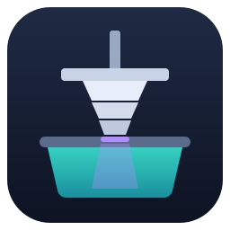

# ChituLinux

Run the Windows version of **CHITUBOX** (the resin 3D printing slicer) on Linux, from one AppImage.

ChituLinux is a patched [Wine](https://www.winehq.org) with [DXVK](https://github.com/doitsujin/dxvk), in its own
Wine prefix, that installs CHITUBOX from CHITUBOX's own Windows installer and fixes what doesn't work out of
the box under Wine.

> ChituLinux is an unofficial project. It is not affiliated with or supported by CBD-Tech (CHITUBOX).
> It contains no CHITUBOX files: you download CHITUBOX's installer yourself.

## Why

CHITUBOX 1.x/2.x is a Qt 6 program that draws with Direct3D 11 and has a built-in browser (Qt WebEngine).
Under a plain Wine it either hangs at the start or closes when you make a new project:

- Qt WebEngine hands its frames to Qt Quick as Direct3D 11 *shared textures*. Wine's own Direct3D can't
  share them at all, DXVK only under Proton; with Wine 10 the render thread spins forever.
  ChituLinux draws the web pages (login, news) without the GPU, the 3D view stays on the GPU.
- CHITUBOX compiles its shaders with `#include "Common.hlsl"` and passes the shader's path with forward
  slashes. Wine's shader compiler then looked for the include in the wrong folder, and CHITUBOX quit on the
  error. Fixed in Wine (`wine/patches/0088-*`).
- CHITUBOX draws its own title bar. Under Wine, maximizing went to the other screen or full screen,
  restoring went back to the wrong screen, and a grey Windows frame showed around it. Fixed in Wine
  (`wine/patches/0089-*` to `0091-*`).

And as with [TopSo'Linux](https://github.com/MichielBruijn/topsolinux), whose patched Wine this uses:

- text and icons at the desktop's scale, or one you choose (right-click the app icon → Settings)
- choose the GPU on a laptop with two (Intel or NVIDIA)
- `Z:` is your home folder, no drive letters for USB sticks and SD cards
- open and save dialogs start in the folder you used last
- an app menu entry with CHITUBOX's own icon, `.chitubox` projects open with it

## Tested

Ubuntu 26.04 (GNOME, Wayland), laptop with Intel Arc + NVIDIA RTX and a 4K monitor, CHITUBOX v1.4.1:
log in, open, slice and save; maximize and restore on either screen.

## What you need

- A 64-bit Linux with glibc 2.38 or newer (Ubuntu 24.04 or newer, Debian 13, Fedora 39 or newer, ...)
- A GPU with a Vulkan driver (Intel, AMD or NVIDIA)
- `zenity` for the dialogs, `python3` with GTK 3 for the settings (both on most desktops)
- CHITUBOX's Windows installer, `CHITUBOX_WIN64_Installer_v….exe`, from
  [chitubox.com](https://www.chitubox.com/en/download/chitubox-free)

## Installing

1. Download CHITUBOX's Windows installer to `~/Downloads`.
2. Download `ChituLinux-<version>-x86_64.AppImage` from the [releases](../../releases), make it executable
   (`chmod +x ChituLinux-*.AppImage`) and start it.
3. ChituLinux finds the newest installer in `~/Downloads` (or asks for it), installs CHITUBOX in its own
   prefix and starts it. CHITUBOX is now in your app menu.

Had CHITUBOX under a plain Wine (`~/.wine`)? ChituLinux offers to take over its settings, printers and
login, so you don't log in again. That installation stays; its app menu entry is hidden.

Keep the AppImage where it is, or start it once after moving it: the menu entry follows it.

Everything is in `~/.local/share/chitulinux` (set `CHITULINUX_HOME` to use another folder); the log is
`chitubox.log` there.

## Updates

- **ChituLinux**: once a day a start of CHITUBOX looks for a newer ChituLinux on GitHub and offers it.
  *Update now* downloads it next to the AppImage you have (checked against `SHA256SUMS`), points the app
  menu at it and removes the old one. Turn the check off in Settings.
- **CHITUBOX**: CHITUBOX says when it has an update. Download its Windows installer to `~/Downloads`; the
  next start offers to install it. Your settings and login stay.

Right-click the app icon → *Check for updates* looks for both right away.

## Commands

```
ChituLinux-<version>-x86_64.AppImage [FILE...]        start CHITUBOX, opening FILEs
ChituLinux-<version>-x86_64.AppImage install [EXE]    install or update CHITUBOX with a (newer) installer
ChituLinux-<version>-x86_64.AppImage update           look for a newer ChituLinux and CHITUBOX
ChituLinux-<version>-x86_64.AppImage update-check on|off
ChituLinux-<version>-x86_64.AppImage settings         scale, GPU, Wine's tools
ChituLinux-<version>-x86_64.AppImage scale 150|auto   size of text and icons
ChituLinux-<version>-x86_64.AppImage winecfg|regedit|shell
ChituLinux-<version>-x86_64.AppImage stop             stop CHITUBOX and Wine
```

## Building

```
./build.sh
```

builds Wine from `wine/UPSTREAM_COMMIT` with `wine/patches` (needs Wine's build dependencies, including
the MinGW cross compilers), downloads DXVK and appimagetool, and makes the AppImage.
Patches 0001–0087 come from TopSo'Linux.

## License

MIT for ChituLinux's own files. Wine and its patches are LGPL 2.1 or later, see [NOTICE.md](NOTICE.md).
